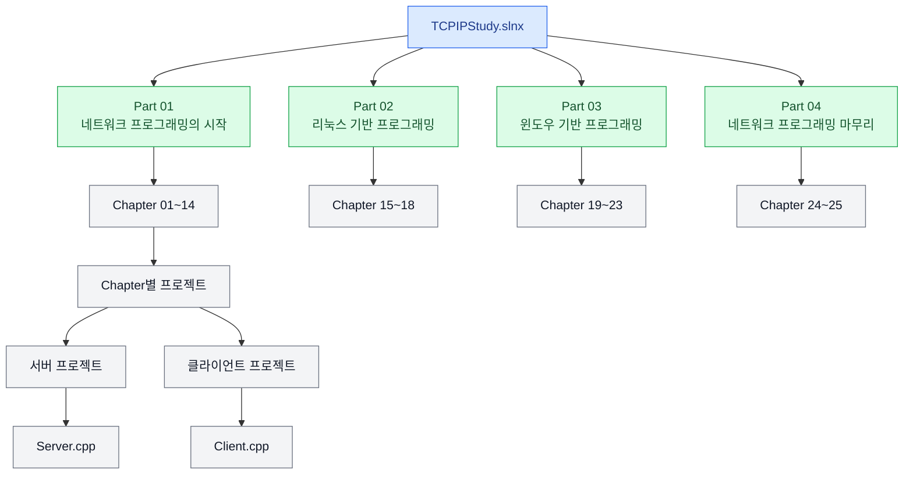

# 📚 윤성우의 열혈 TCP/IP 소켓 프로그래밍

TCP/IP 네트워크의 기본 원리를 학습하고, C/C++ 소켓 프로그래밍을 통해 클라이언트와 서버 간 통신을 직접 구현하는 학습 저장소입니다.

> **교재:** 윤성우의 열혈 TCP/IP 소켓 프로그래밍  
> **개발 환경:** Visual Studio 2026  
> **언어:** C / C++  
> **진행 상태:** 학습 진행 중

---

## 🎯 1. 학습 목적

네트워크 통신의 기본 원리를 이해하고, 소켓 프로그래밍을 통해 클라이언트와 서버가 데이터를 주고받는 과정을 직접 구현합니다.

단순히 예제 코드를 따라 작성하는 것에 그치지 않고, 함수의 역할과 호출 순서, 데이터가 전달되는 과정을 이해하고 설명할 수 있는 수준을 목표로 합니다.

### 세부 목표

- IP 주소, 포트 번호, TCP, UDP 등 네트워크 기초 개념 이해
- 소켓을 이용한 클라이언트·서버 프로그램 구현
- 연결 설정, 데이터 송수신, 연결 종료 및 오류 처리 과정 이해
- 프로세스와 스레드를 활용한 다중 접속 서버의 기본 원리 이해
- 운영체제별 소켓 프로그래밍 방식과 입출력 처리 모델 이해
- 간단한 HTTP 서버를 구현하여 TCP/IP와 웹 통신의 관계 이해

---

## 💡 2. 학습 필요성

TCP/IP는 네트워크를 통해 데이터를 주고받는 프로그램의 기반 기술입니다.

이러한 기초를 이해하면 HTTP, Spring Boot, AWS 등을 공부할 때 개별 기능의 사용법뿐 아니라 서버와 클라이언트 사이에서 일어나는 통신 과정도 이해하기 쉬워집니다.

| 학습 분야 | TCP/IP 학습과의 연관성 |
|---|---|
| 네트워크 | IP 주소, 포트, TCP 연결, 데이터 송수신의 기본 원리 이해 |
| HTTP / HTTPS | 요청과 응답의 구조 및 네트워크 통신과의 관계 이해 |
| Spring Boot | 웹 요청이 서버에 전달되고 처리 결과가 반환되는 과정 이해 |
| AWS | EC2, 보안 그룹, VPC 등 네트워크 관련 개념을 학습하기 위한 기초 마련 |
| 서버 프로그래밍 | 동시 접속, 프로세스, 스레드, 입출력 처리 모델 이해 |

※ 이 책이 HTTP, Spring Boot, AWS를 직접 가르치는 것은 아닙니다. 네트워크 기초를 먼저 학습하고, 이후 각 기술을 별도로 공부하면서 지식을 연결하는 것이 목표입니다.

---

## 🛠️ 3. 개발 환경

| 항목 | 내용 |
|---|---|
| IDE | Visual Studio 2026 |
| 프로그래밍 언어 | C / C++ |
| 솔루션 | `TCPIPStudy.slnx` |
| 형상 관리 | Git / GitHub |
| 학습 자료 | 윤성우의 열혈 TCP/IP 소켓 프로그래밍 |

### 실습 원칙

1. 개념을 학습한 뒤 직접 코드를 작성합니다.
2. 예제를 실행하고 실제 데이터 송수신 결과를 확인합니다.
3. 서버와 클라이언트 등 독립적으로 실행되는 프로그램은 각각 별도 프로젝트로 구성합니다.
4. 오류가 발생하면 원인을 분석하고 해결 과정을 기록합니다.
5. 코드를 보지 않고도 주요 함수의 역할과 프로그램의 동작 과정을 설명할 수 있는지 확인합니다.

---

## 🗂️ 4. 프로젝트 구조

### 4.1 현재 저장소 구조

현재 생성된 구조를 기준으로 학습을 시작하고, 진도에 따라 챕터별 프로젝트를 추가합니다.

```text
TCPIPStudy/
├── .gitattributes
├── .gitignore
├── README.md
├── TCPIPStudy.slnx
│
└── Part01_NetworkProgramming/
    └── Ch01_Network_programming_and_sockets/
        └── Chapter 01 실습 프로젝트
```

※ 마지막 항목은 해당 폴더 내부의 프로젝트와 소스 코드를 의미합니다. 실제 프로젝트 파일과 소스 파일은 해당 폴더에 저장됩니다.

### 4.2 프로젝트 구성 원칙

- **솔루션:** 전체 학습 프로젝트를 관리합니다.
- **Part 폴더:** 교재의 Part 01~04를 기준으로 파일을 분류합니다.
- **Chapter 폴더:** 각 장의 실습 프로젝트를 보관합니다.
- **프로젝트:** 실행 파일을 빌드하고 관련 설정을 관리합니다.
- **소스 파일:** 실제 코드를 작성하는 `.cpp`, `.h` 등의 파일입니다.

서버와 클라이언트처럼 독립 실행이 필요한 프로그램은 별도 프로젝트로 구성합니다. 반면 같은 프로그램을 단계적으로 수정하는 실습은 기존 프로젝트에서 진행합니다.

### 4.3 향후 목표 구조

아래는 전체 학습을 마칠 때까지 점진적으로 구성할 목표 구조입니다. 아직 학습하지 않은 Part와 Chapter의 디렉터리는 진도에 맞춰 추가합니다.

```text
TCPIPStudy/
├── TCPIPStudy.slnx
├── README.md
│
├── Part01_NetworkProgramming/
│   ├── Ch01_Network_programming_and_sockets/
│   ├── Ch02_SocketTypesAndProtocols/
│   ├── Ch03_AddressAndByteOrder/
│   ├── Ch04_TCPServerClient1/
│   ├── Ch05_TCPServerClient2/
│   ├── Ch06_UDPServerClient/
│   ├── Ch07_HalfClose/
│   ├── Ch08_DNS/
│   ├── Ch09_SocketOptions/
│   ├── Ch10_MultiProcessServer/
│   ├── Ch11_IPC/
│   ├── Ch12_IOMultiplexing/
│   ├── Ch13_IOFunctions/
│   └── Ch14_MulticastBroadcast/
│
├── Part02_LinuxProgramming/
│   ├── Ch15_StandardIO/
│   ├── Ch16_IOStreamSeparation/
│   ├── Ch17_Epoll/
│   └── Ch18_MultithreadServer/
│
├── Part03_WindowsProgramming/
│   ├── Ch19_WindowsThreads/
│   ├── Ch20_ThreadSynchronization/
│   ├── Ch21_AsyncNotificationIO/
│   ├── Ch22_OverlappedIO/
│   └── Ch23_IOCP/
│
└── Part04_NetworkProgrammingWrapUp/
    ├── Ch24_HTTPServer/
    └── Ch25_NextSteps/
```

각 Chapter 폴더 내부에는 필요한 Visual Studio 프로젝트와 소스 파일을 추가합니다. 한 Chapter 안에 여러 개의 독립 실행 프로그램이 있다면 프로젝트를 추가로 분리합니다.

### 프로젝트 구조도



> **개발 환경 참고:** Part 02는 Linux 기반 프로그래밍을 다루므로 WSL 등 Linux 환경을 활용해 실습합니다. Part 03은 Windows 환경을 중심으로 진행합니다. Part 01에는 Linux와 Windows 기반 예제가 함께 있으므로, 각 예제의 실행 환경을 확인하고 실습합니다.

---

## 📖 5. 학습 목차 및 진행 상황

교재의 Part와 Chapter 구성을 기준으로 학습 내용을 정리합니다. 완료한 항목은 체크하여 진도를 기록합니다.

### Part 01. 네트워크 프로그래밍의 시작

네트워크와 소켓의 기초부터 TCP·UDP 통신, 다중 접속 서버, 입출력 처리까지 학습합니다.

- [ ] **Chapter 01.** 네트워크 프로그래밍과 소켓의 이해
- [ ] **Chapter 02.** 소켓의 타입과 프로토콜의 설정
- [ ] **Chapter 03.** 주소체계와 데이터 정렬
- [ ] **Chapter 04.** TCP 기반 서버/클라이언트 1
- [ ] **Chapter 05.** TCP 기반 서버/클라이언트 2
- [ ] **Chapter 06.** UDP 기반 서버/클라이언트
- [ ] **Chapter 07.** 소켓의 우아한 연결종료
- [ ] **Chapter 08.** 도메인 이름과 인터넷 주소
- [ ] **Chapter 09.** 소켓의 다양한 옵션
- [ ] **Chapter 10.** 멀티프로세스 기반의 서버구현
- [ ] **Chapter 11.** 프로세스간 통신(IPC)
- [ ] **Chapter 12.** IO 멀티플렉싱(Multiplexing)
- [ ] **Chapter 13.** 다양한 입출력 함수들
- [ ] **Chapter 14.** 멀티캐스트 & 브로드캐스트

**핵심 목표**

- 소켓 생성부터 연결 및 데이터 송수신까지 구현하기
- IP 주소, 포트 번호, TCP, UDP, DNS의 역할 설명하기
- TCP의 연결 종료와 데이터 송수신 특성 이해하기
- 다중 접속 서버와 입출력 다중화의 기본 원리 이해하기

### Part 02. 리눅스 기반 프로그래밍

Linux 환경의 입출력 처리 방식과 서버 구현 방법을 학습합니다.

- [ ] **Chapter 15.** 소켓과 표준 입출력
- [ ] **Chapter 16.** 입출력 스트림의 분리에 대한 나머지 이야기
- [ ] **Chapter 17.** select보다 나은 epoll
- [ ] **Chapter 18.** 멀티쓰레드 기반의 서버구현

**핵심 목표**

- 소켓과 표준 입출력의 관계 이해하기
- 입력·출력 스트림 분리의 의미 이해하기
- `select`와 `epoll`의 기본적인 차이 이해하기
- 멀티스레드와 동기화의 기초 이해하기

### Part 03. 윈도우 기반 프로그래밍

Windows의 스레드, 동기화, 비동기 입출력 및 IOCP 기반 처리 모델을 학습합니다.

- [ ] **Chapter 19.** Windows에서의 쓰레드 사용
- [ ] **Chapter 20.** Windows에서의 쓰레드 동기화
- [ ] **Chapter 21.** Asynchronous Notification IO 모델
- [ ] **Chapter 22.** Overlapped IO 모델
- [ ] **Chapter 23.** IOCP(Input Output Completion Port)

**핵심 목표**

- Windows 스레드와 커널 오브젝트의 기본 개념 이해하기
- 스레드 동기화가 필요한 이유 이해하기
- 비동기 입출력 모델의 차이 이해하기
- IOCP의 기본 동작 원리 이해하기

### Part 04. 네트워크 프로그래밍 마무리하기

HTTP 서버를 구현하고 네트워크 프로그래밍의 후속 학습 방향을 정리합니다.

- [ ] **Chapter 24.** HTTP 서버 제작하기
- [ ] **Chapter 25.** 앞으로 해야 할 것들

**핵심 목표**

- HTTP 요청과 응답의 기본 구조 이해하기
- 간단한 HTTP 서버 구현하기
- HTTP와 TCP 소켓의 관계 설명하기
- 이후 학습할 네트워크 및 웹 기술 정리하기

---

## 🧪 6. 주요 실습 계획

| 실습 | 목표 |
|---|---|
| TCP 에코 서버·클라이언트 | 문자열 송수신 및 기본적인 소켓 통신 구현 |
| 반복 송수신 프로그램 | 하나의 연결에서 여러 차례 데이터를 주고받기 |
| UDP 서버·클라이언트 | 비연결형 데이터 송수신 방식 이해 |
| 연결 종료 실습 | TCP 연결 종료와 Half-close 동작 이해 |
| 다중 접속 서버 | 여러 클라이언트의 연결을 처리하는 방식 이해 |
| 입출력 다중화 실습 | 여러 소켓의 입출력 상태를 처리하는 원리 이해 |
| 멀티스레드 서버 | 동시 처리와 동기화의 기본 원리 이해 |
| 간단한 HTTP 서버 | HTTP 요청을 수신하고 응답을 반환하는 과정 이해 |

각 실습은 교재의 해당 내용을 학습한 뒤 진행합니다. 필요에 따라 별도의 테스트 코드와 실행 결과를 추가합니다.

---

## 📝 7. 학습 기록 및 복습 방법

각 Chapter의 학습이 끝나면 다음 내용을 기록합니다.

- **핵심 개념:** 새롭게 학습한 용어와 동작 원리
- **코드 실습:** 직접 작성한 코드와 실행 결과
- **문제 해결:** 발생한 오류, 원인 분석 및 해결 방법
- **이해도 점검:** 코드를 보지 않고 설명할 수 있는 내용
- **추가 학습:** 이해가 부족하거나 더 알아보고 싶은 개념

코드 작성 자체보다 각 함수의 역할, 호출 순서 및 실제 데이터 송수신 과정을 설명할 수 있는지를 중요하게 확인합니다.

---

## 🚀 8. 이후 학습 방향

TCP/IP 소켓 프로그래밍의 기본 개념을 학습한 뒤 웹 애플리케이션 개발과 클라우드 환경으로 학습을 확장합니다.

1. **HTTP / HTTPS:** 메서드, 헤더, 상태 코드, 요청·응답 구조
2. **Java 네트워크 기초:** Java 환경에서의 소켓 통신
3. **Spring Boot:** REST API 서버 구현 및 HTTP 요청 처리
4. **AWS:** EC2 배포, 보안 그룹, VPC, DNS 등 네트워크 관련 구성

최종적으로 네트워크 통신의 기본 원리를 이해하고, 웹 서버와 클라우드 환경에서 발생하는 통신 과정을 파악할 수 있는 기초 역량을 갖추는 것을 목표로 합니다.

---

## 📚 참고 자료

- [윤성우의 열혈 TCP/IP 소켓 프로그래밍 — 도서 정보 및 목차](https://www.yes24.com/product/goods/3630373)
- [TCPIPStudy GitHub 저장소](https://github.com/CHEDDARcb/TCPIPStudy)

---

## ✅ 학습 원칙

- 개념을 이해한 뒤 코드를 작성합니다.
- 예제를 직접 실행하고 결과를 확인합니다.
- 오류가 발생하면 원인을 분석하고 해결 과정을 기록합니다.
- 코드를 보지 않고 핵심 동작을 설명할 수 있는지 확인합니다.
- 모든 내용을 처음부터 완벽하게 이해하려 하기보다 구현과 복습을 반복하며 이해도를 높입니다.
